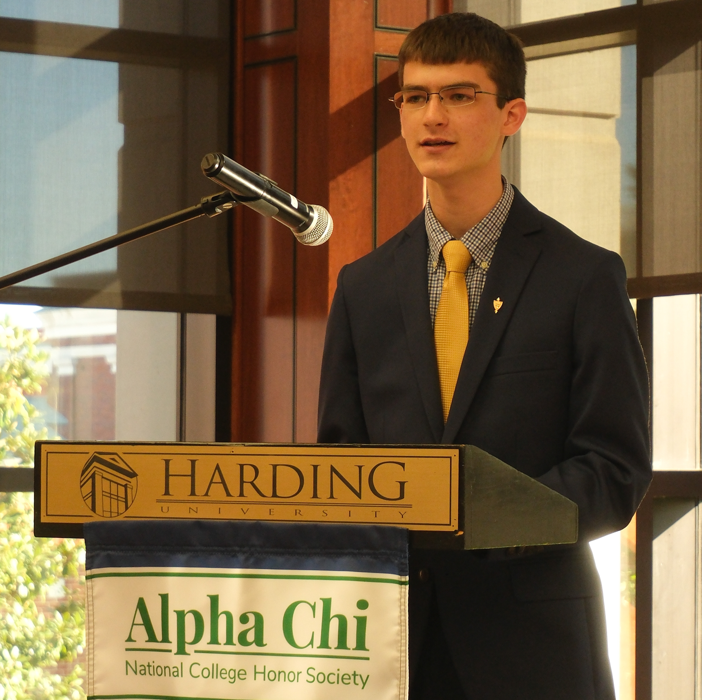

I am a researcher based at **Harding University**, specializing in the intersection of digital forensics, rural policing, and privacy law. My work investigates how resource constraints impact the adoption of forensic technology in the rural South.

With a background in **Information Assurance**, I combine technical systems analysis with social theory to address the "Black Box" problem in criminal justice.

### Featured Projects 

**"Stalled at the County Line"**

A mixed-methods study to investigate the operational gap between vehicle forensic capability and investigative need in rural law enforcement. Supported by the **Arkansas ADHE Research Fellowship.**

[Read Executive Summary](/files/Stalled_Executive_Summary.pdf)

**"The Rolling Bailment"**

A legal analysis arguing for the application of **Bailment Theory** to resolve the constitutional ambiguity of vehicle telematics data following *Carpenter v. United States*.
